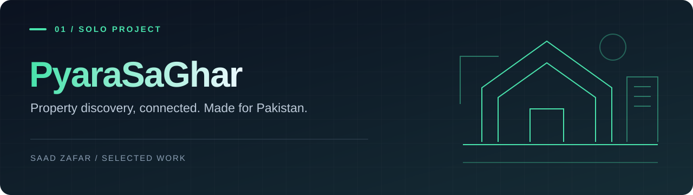
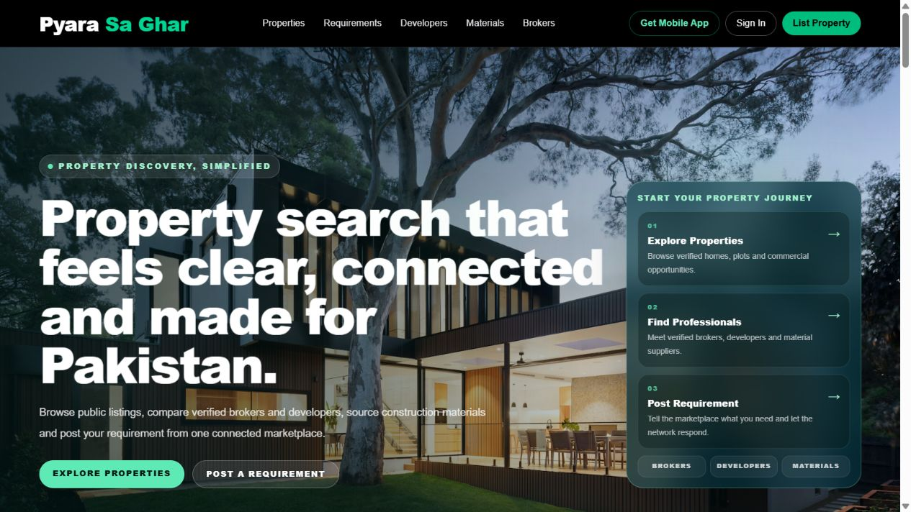
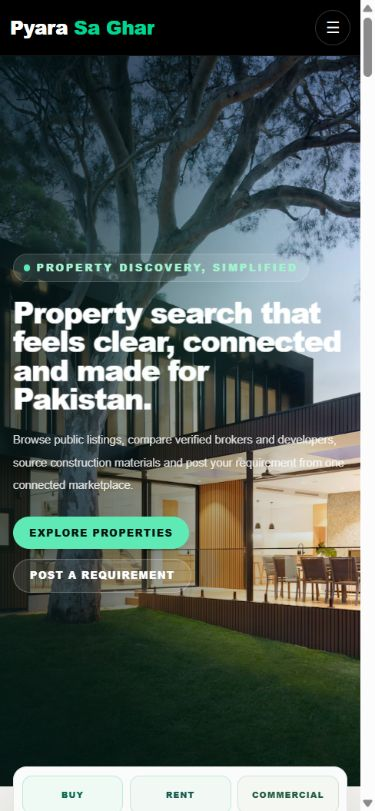

  

<b><a href="https://pyarasaghar.com/">Visit the live website ↗</a></b> · <a href="https://github.com/Saad-Zafar1">Back to my portfolio</a>

## A connected property journey

**PyaraSaGhar** is a property marketplace for Pakistan. It brings property discovery, public professional directories, construction materials, and property requirements into one website.

## My role

**Saad Zafar — sole designer and developer.**

I designed and built the entire website independently, from the visual presentation and page structure to its development. This is my solo project.

## Inside the experience

| Area | What visitors can explore |
| --- | --- |
| Property discovery | Homes, plots, and commercial listings, with search entry points for buying and renting. |
| Professional directories | Public broker and developer pages. |
| Construction ecosystem | Building materials and supplier discovery. |
| Property requirements | A dedicated entry point for sharing property needs. |
| Property promotion | Advertising information and listing promotion options. |

## On a smaller screen

## Explore it yourself

- **[Open PyaraSaGhar](https://pyarasaghar.com/)**
- **[Browse the public property listings](https://pyarasaghar.com/properties)**
- **[See my other featured project: TEDxUMT Lahore](https://github.com/Saad-Zafar1/tedx-umt-showcase)**

---

This repository is a portfolio showcase containing presentation assets and documentation. Website application source code, backend configuration, and private data are not included. Screenshots show the public website as captured on 17 November 2026; the live site may change.
